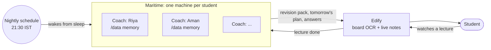

# Edify: every lecture, understood

**Every student gets their own AI study coach: an agent that saw every lecture they watched, remembers what they keep
getting wrong, and plans their next day while they sleep.**

Indian students spend lectures copying the board instead of understanding it. Edify reads the board with them, writes
exam-ready notes as the teacher speaks, and quizzes them the moment the topic changes. It explains in the language the
student thinks in: English, Hinglish, Hindi, Marathi, Bengali, Tamil, Telugu or Gujarati, each in its own script, with
every formula and number checked against the English.
Then **Edify Coach** takes over: one agent per student, running on [Maritime](https://maritime.sh).

## Edify Coach, on Maritime

| What the coach does | When |
| --- | --- |
| Writes a **revision pack**: key ideas, formulas, solved exam-style questions, tied to the student's weak spots | Every time a lecture ends |
| **Re-plans the next day** from spaced revisions due (day 1, 3 and 7), open weak topics and the last mock test | Every night, when Maritime wakes it |
| **Answers questions** with everything it remembers about that student | Any time |

**How it uses Maritime** ([`backend/app/services/coach.py`](backend/app/services/coach.py)):

- **One machine per student:** each student is a Maritime *end user* (`edify_<id>`) with their own agent, built from
  [`agents/edify-coach`](agents/edify-coach), created exactly once.
- **Memory that lasts:** the coach keeps each student's history under `/data`, which survives sleep, restarts and
  redeploys, so it knows the student better every week.
- **Sleeps, then wakes:** each machine is on the *smart* tier ($1 a month). It sleeps when idle and wakes for a chat or
  for its nightly schedule (`GET /schedules`, plus a platform cron trigger).
- **Guarded per student:** a Maritime policy (AI spend cap, wakes per hour, compute minutes) is in place before the
  machine exists. Edify's own AI key never goes onto a coach machine.
- **Watched as a fleet:** the admin panel reads Maritime's end-user summary: activity, messages and AI spend per student.

**Status:** the integration is built and tested against Maritime's API (`api.maritime.sh/openapi.json`). Every student
who turns their coach on is registered on Maritime straight away, as an end user with their own limits; deleting the
account removes them there too. Maritime needs a card on the account before any machine starts, so until one is added
`run.bat` runs the same coach on this computer, keeping each student's memory apart. Setting `MARITIME_COACH_REPO` in
`backend/.env` moves every coach to Maritime.

## Built during the hackathon

Each of these is in the commit history as small, separate commits:

| What | Where to see it |
| --- | --- |
| **Edify Coach**: one agent per student, with its own memory, a nightly re-plan, and the student registered on Maritime with their own limits from day one | Dashboard → Edify Coach; admin → Coach fleet |
| **Root-cause tracing**: a weak topic traced back through earlier chapters to the real gap, then a five-minute fix and a re-check. A check's marked answer must agree with its own working | Root cause |
| **Before and after**: three questions on the stuck topic before the trace and three others after the fix, from the question bank (no AI), so a student sees what fixing the root changed | Root cause → a fixed trace |
| **Where a batch's gaps start**: every student's traces added up for the teacher, with what to teach first and a 10-minute recap for the board, reusing the lesson its students got. Counts only, nobody named | Classes → a class |
| **Next-class kit**: from the boards that lost a live class, a simpler explanation, an analogy, board lines and opener questions | A room's confusion map |
| **Mother tongues**: Marathi, Bengali, Tamil, Telugu and Gujarati join Hindi and Hinglish, each checked to be in its own script | Settings → Explain things to me in |
| **Measured, not estimated**: the stuck topic before → after the fix, roots found, fixes that held, time to fix, chains reused and AI cost per student, from real students' traces (demo accounts never count) | Admin → Root-cause tracing, measured |

`python backend/scripts/seed_demo.py` makes demo accounts with all of it ready to show (every name starts with "Demo").

## The rest of Edify

- **EdifyOCR**: our own model for lecture boards (chalk, marker, pen tablet, slides; Greek letters and maths symbols)
- **Live notes and pop quizzes** over any lecture in a browser tab, or a photo of a classroom board
- **Mock tests** in the real JEE / NEET / SSC pattern, with weak-chapter analysis
- **Study rooms**, **mentors** who cleared the exam, flashcards with spaced repetition, last-day revision

## Run it

1. Install Python 3.12 and Node.js 20+.
2. Copy `.env.example` to `backend/.env` and add a free `GROQ_API_KEY` for AI notes.
3. Double-click `run.bat`. Edify opens at http://localhost:8000, with the coach alongside it.
4. Sign up, then on the dashboard: **Turn on my coach**, then **Try it with a sample lecture**.

Tests: `cd backend && python -m pytest` (450+ tests, including the coach end to end against a running agent).
