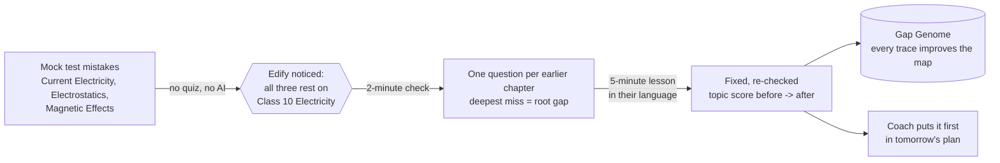

# Edify: every lecture, understood

**A student failing Electrostatics is rarely missing Electrostatics. They're missing Class 10 Electricity, or Class 8
ratios. Coaching re-teaches the symptom. Edify finds the cause, fixes it in five minutes, and proves it worked.**

Indian students spend lectures copying the board instead of understanding it, then fail chapters whose real gap is
years behind them. Edify reads the board with them, writes exam-ready notes as the teacher speaks, and explains in the
language the student thinks in: English, Hinglish, Hindi, Marathi, Bengali, Tamil, Telugu or Gujarati, with every
formula and number checked against the English. Then it goes after the real gap.

## Root cause, end to end

1. **Silent tracing.** Edify reads the mistakes a student already made. When two or more weak chapters rest on the
   same earlier chapter, that chapter is the likely root, found with no quiz and no AI
   ([`gaps.suspects`](backend/app/services/gaps.py)).
2. **Two-minute check.** One question per earlier chapter, going down through the classes (JEE/NEET → Class 10 →
   Class 7). The deepest wrong answer is the root gap. Chapters come from the real syllabus only; invented chapters and
   questions whose marked answer disagrees with their own working are dropped.
3. **Five-minute fix.** A lesson on the root idea in the student's language, a fresh re-check, and three questions on
   the stuck topic before and after, so the student sees what fixing the root changed.
4. **Gap Genome.** Every chain joined into one map of what JEE and NEET really rest on, weighted by real students'
   traces. Today it maps 23 exam chapters onto 41 school chapters. The load-bearing ones, like Class 10 Electricity
   under three Physics chapters, are where one fix pays off several times.
5. **Shared, so it gets cheaper.** A chapter's chain is built once and reused by every student after: the first trace
   costs a few seconds of AI, every later one costs nothing. `python backend/scripts/warm_chains.py` builds the top
   chapters ahead.

## Edify Coach

A personal coach for every student, with its own memory of their lectures, mistakes and root gaps
([`agents/edify-coach`](agents/edify-coach)).

| What the coach does | When |
| --- | --- |
| Writes a **revision pack**: key ideas, formulas, solved exam-style questions, tied to the student's weak spots | Every time a lecture ends |
| **Re-plans the next day**: a confirmed root gap first, else a 2-minute check on the likeliest suspected one, then spaced revisions (day 1, 3, 7), weak topics and the last mock | Every night at 21:30 IST |
| **Answers questions** with everything it remembers about that student | Any time |

Each student's memory is kept apart, and each has an AI spend cap. `run.bat` runs the coach on this computer.

**Ready to scale:** the coach is also built to run as one sleeping cloud machine per student on
[Maritime](https://maritime.sh), with per-student spend, wake and compute limits set before the machine exists and an
admin fleet view ([`backend/app/services/coach.py`](backend/app/services/coach.py)). It is tested against Maritime's
API; setting `MARITIME_COACH_REPO` in `backend/.env` moves every coach there.

## Built during the hackathon

Each of these is in the commit history as small, separate commits:

| What | Where to see it |
| --- | --- |
| **Silent tracing**: the likely root gap found from mock-test mistakes alone, before any quiz, with a one-tap check | Root cause → "Edify noticed" |
| **Gap Genome**: every traced chapter joined into one map of what JEE and NEET rest on, weighted by real traces | Gap Genome |
| **Edify Coach**: one agent per student, with its own memory and a nightly re-plan that puts the root gap first | Dashboard → Edify Coach |
| **Root-cause tracing**: a weak topic traced back through earlier chapters to the real gap, then a five-minute fix and a re-check. A check's marked answer must agree with its own working | Root cause |
| **Before and after**: three questions on the stuck topic before the trace and three others after the fix, from the question bank (no AI), so a student sees what fixing the root changed | Root cause → a fixed trace |
| **Where a batch's gaps start**: every student's traces added up for the teacher, with what to teach first and a 10-minute recap for the board, reusing the lesson its students got. Counts only, nobody named | Classes → a class |
| **Next-class kit**: from the boards that lost a live class, a simpler explanation, an analogy, board lines and opener questions | A room's confusion map |
| **Mother tongues**: Marathi, Bengali, Tamil, Telugu and Gujarati join Hindi and Hinglish, each checked to be in its own script | Settings → Explain things to me in |
| **Measured, not estimated**: the stuck topic before → after the fix, roots found, fixes that held, time to fix, chains reused and AI cost per student, from real students' traces (demo accounts never count) | Admin → Root-cause tracing, measured |

`python backend/scripts/seed_demo.py` makes demo accounts with all of it ready to show (every name starts with "Demo").

**The 90-second demo** (after `warm_chains.py` and `seed_demo.py`, signed in as `demo.focs.student@example.com`):
Root cause opens with *Edify noticed*: three Physics chapters from the last mock all rest on Class 10 Electricity →
**Check it in 2 minutes** finds the gap → the five-minute fix in Hinglish → the trace shows the stuck topic before and
after → Gap Genome shows where that chapter sits under the rest of JEE.

## The rest of Edify

- **EdifyOCR**: our own model for lecture boards (chalk, marker, pen tablet, slides; Greek letters and maths symbols)
- **Live notes and pop quizzes** over any lecture in a browser tab, or a photo of a classroom board
- **Mock tests** in the real JEE / NEET / SSC pattern, with weak-chapter analysis
- **Study rooms**, **mentors** who cleared the exam, flashcards with spaced repetition, last-day revision

## Run it

1. Install Python 3.12 and Node.js 20+.
2. Copy `.env.example` to `backend/.env` and add a free `GROQ_API_KEY` for AI notes.
3. Double-click `run.bat`. Edify opens at http://localhost:8000, with the coach alongside it.
4. Sign up, then on the dashboard: **Turn on my coach**, then **Try it with a sample lecture**.

Tests: `cd backend && python -m pytest` (450+ tests, including the coach end to end against a running agent).
